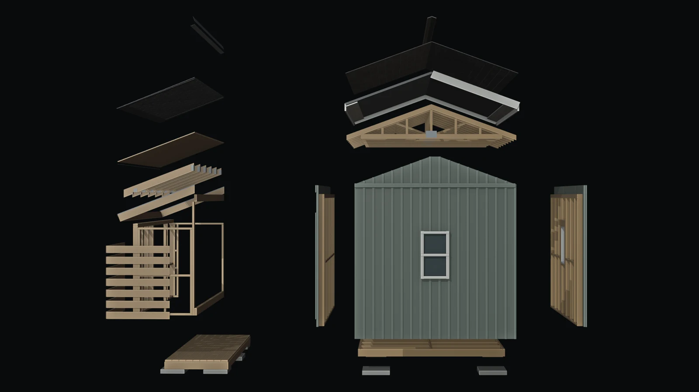

# Blackblend

**Design, in motion.** Turn a 3D assembly into a product film, with agent-assisted editing and source-to-result comparison.

[Open Studio](https://blackblend-studio.mgd1984.workers.dev/studio) · [Watch the demo](https://youtu.be/BZyJ6gSjerM) · [Public source](https://github.com/mgd1984/blackblend-build-north-2026)



## From assembly to film

1. **Inspect** — select, isolate and explore the parts of an assembly.
2. **Animate** — direct the camera, explosion and reassembly; export a preview video or import a Blender animation.
3. **Finish** — add reference images and visual direction, then confirm the price to generate a treatment.
4. **Compare** — play source and result together to review what changed.

The examples include a woodshed, a PTZ camera rig and a Massey-Harris combine. Published comparison videos are available without a paid request. Detailed native models are private; a local checkout without them loads a labelled concept scene.

Chat edits can be previewed, applied and undone. The hosted Blender integration turns an agent-requested geometry change into a saved, editable model revision. The roadmap extends this workflow to broader agentic CAD, engineering review and digital twins.

## Run locally

Use Node 22 LTS or 24+, with ffmpeg and ffprobe for media tests:

```sh
npm ci
npm run db:local
npm run dev
```

Open http://127.0.0.1:4331. [Setup](docs/setup.md) covers Clerk configuration, private storage and provider access.

```sh
npm run format:check
npm run typecheck
npm test
npm run build
npm run check:dependencies
```

Tests use synthetic scenes and mocked providers. These commands do not deploy or purchase generation.

## Stack

React, TypeScript and vinext; Three.js and browser MP4 encoding; Clerk authentication; Cloudflare Workers, D1 and R2; OpenAI Agents SDK for scene proposals and hosted Blender execution; fal for animation-conditioned video generation. Paid tools are restricted to approved accounts. Customer billing is not enabled.

## Guides

- [Studio](docs/studio.md) — parts, camera, animation and comparison
- [Product](docs/product.md) — customer, business model and roadmap
- [Architecture](docs/architecture.md) — application and service boundaries
- [Setup](docs/setup.md) — development, deployment and credentials
- [Blender](docs/blender.md) — native editing and validation
- [Billing](docs/billing.md) — sandbox integration
- [Demo](docs/demo.md) — a short walkthrough

## Build North

The woodshed, PTZ rig, combine and earlier visualization experiments predate Build Week. The submission builds and consolidates the Studio, browser animation capture, scene proposals, comparison, account protection and hosted generation workflow around those assets. OpenAI Codex assisted development; AI-assisted imagery and video are identified in the media notes. Clerk provides session identity, with server-side checks protecting each account’s projects and files.

The public repository is a source snapshot. Its README records the snapshot date and source revision. Private models, photos and credentials are excluded. Third-party notices remain with their code.

Snapshot: 25 October 2026 · source revision `e05bc53410bd68f597c93ac77b7665aa4694f59c`.
