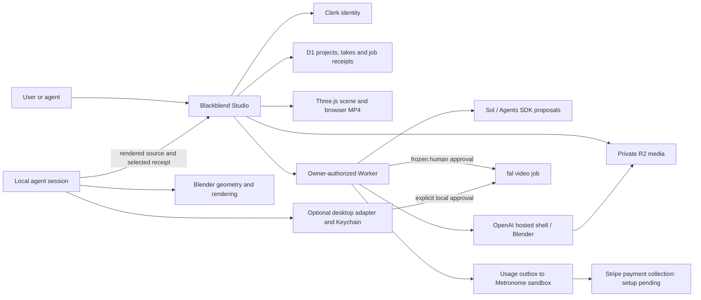

# Blackblend architecture

22 October 2026. One application, one project ledger, one optional desktop execution adapter. Hosted execution is a restricted operator preview; commercial billing remains disabled.

| Component | Responsibility | Source |
| --- | --- | --- |
| Studio | Interactive scene, chat proposals, choreography, examples, project review and comparison | `apps/studio` |
| Cloudflare Worker | Clerk session verification, owner checks, D1 and R2 operations | `apps/studio/worker`, `lib`, `app/api` |
| Blender | Native geometry, camera, component motion and rendering | `blender/` |
| Desktop adapter | Loopback execution API, Keychain, one approved submission, polling and local media | `server.mjs`, `workflow.mjs`, provider adapters |
| Local development capabilities | Private woodshed export, Keychain-backed scene proposals, MP4 encoding, frozen approval preparation and selected receipt transfer | `apps/studio/dev/scene-runtime.ts`, `scene-execution.mjs` |

The adapter is an implementation dependency of local execution. Its only browser page is an input-bound paid-job approval screen. Studio stores project context; ignored local run records retain execution receipts and files. Local Studio can prepare an approval and import the selected receipt/result directly. Blender handoffs can also be agent-mediated. A hosted preparation action does not start Blender or authorize spending.

Scene documents contain bounded component transforms, camera, choreography and assumptions. Proposals validate against a base revision, require human Apply and support undo. Saved D1 scene documents use version checks; rendered takes retain their scene snapshot. The GLB remains a private source asset. Local chat uses Keychain; hosted chat uses Worker secrets and durable owner-scoped request receipts. Both use the Sol Agents SDK runner and validated scene tools. The hosted native-window tool uses a pinned offline Blender runtime in OpenAI hosted shell and owner-scoped R2 revisions; it does not execute model-generated code. See [hosted native geometry](HOSTED-BLENDER.md).

## Consolidated source

- One npm workspace application: `apps/studio`.
- One root install/lockfile and one CI verification job.
- One Clerk authentication path. Platform identity headers are never accepted as authentication.
- One Cloudflare deployment target using the existing D1/R2 resource IDs.
- The old Convex app, Sites target, Python prototype and standalone lab frontend are removed. Git history retains previous source. Existing remote services/data have not been deleted or migrated.
- `/workflows` and `/workspace` only redirect old bookmarks into Studio; they contain no alternative interface.

## Boundaries

The edge Worker cannot read desktop files, spawn Blender or access Keychain. Native Blender executes in an offline OpenAI-hosted shell container. The local capabilities above are Vite development middleware and are absent from the hosted Worker. Hosted chat and generation require explicit account allowlists and server secrets. A fresh deployment uses a labelled concept woodshed until its private R2 source asset is provisioned. No tunnel or automatic desktop pairing exists. The hosted native runtime is provisioned, its production executor has passed the woodshed check on OpenAI, and the operator-only Studio is deployed with private source access. One authorized browser-to-container window edit, native Apply/Undo/Redo, and container deletion have been verified for the operator account; general scene execution and external-user validation remain unverified. Cloudflare Containers is absent from this target; the account plan is unchanged. Hosted provider submission is an explicit operator action; customer commercial spending is disabled. Loopback host/origin checks and action tokens remain required. A human reviews frozen source, references, prompt and quality before hosted approval in Studio, or on the local approval page for desktop execution. Unknown submit outcomes require inspection rather than a second POST.

Vite and Wrangler use the same Workers runtime for local persistence. Development and local preview use that runtime’s supported compatibility date; production settings stay unchanged. A build is not a deployment or a live provider test.

## Hosted generation and billing

[Hosted generation](HOSTED-GENERATION.md) describes the single-submit claim, frozen approval, expiring provider media access and result comparison. [Usage billing](METERED-BILLING.md) describes the durable sandbox customer mapping, usage dispatcher and signed notification inbox. D1 records execution facts; Metronome owns rating/contracts, and Stripe owns payment collection. Ingestion acceptance and webhook receipt do not authorize customer spend. No schedule or commercial billing is activated by the code.
